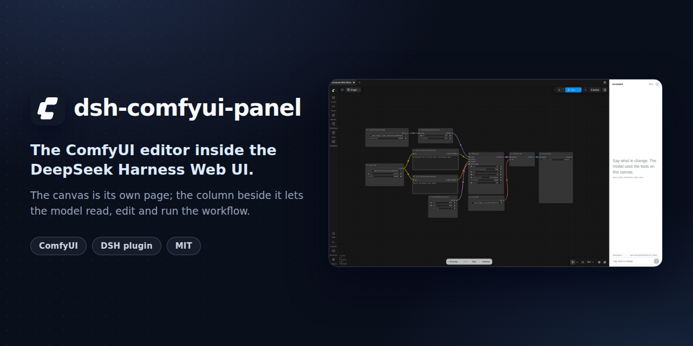
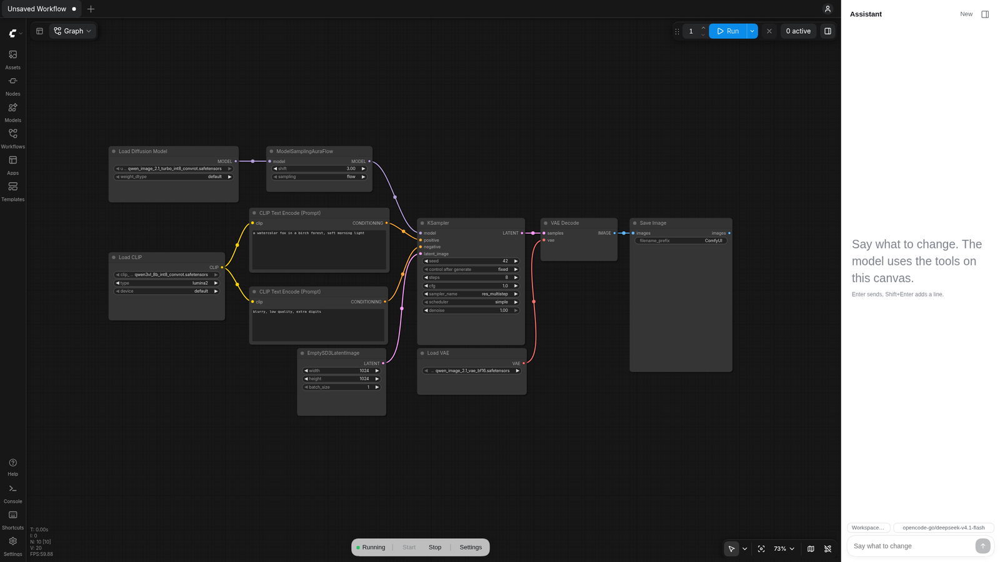
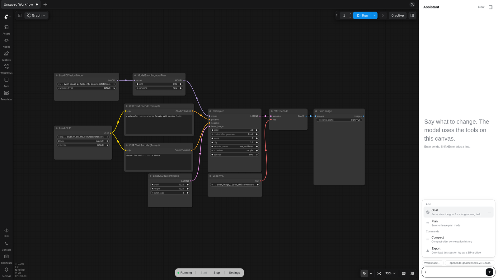
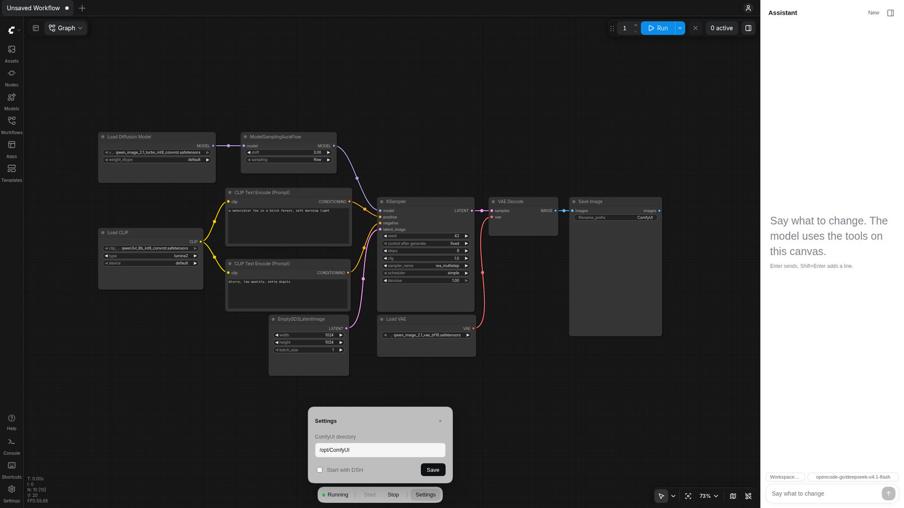

# dsh-comfyui-panel

[简体中文](https://github.com/Natsubrei/dsh-comfyui-panel/blob/main/README.md) · [English](https://github.com/Natsubrei/dsh-comfyui-panel/blob/main/README_en.md)

[](https://www.npmjs.com/package/dsh-comfyui-panel)
[](https://github.com/Natsubrei/dsh-comfyui-panel)
[](https://dshfind.com/en/plugins/Natsubrei/dsh-comfyui-panel?ref=badge)
[](https://github.com/Natsubrei/dsh-comfyui-panel/actions/workflows/test.yml)
[](LICENSE)

**The ComfyUI editor as its own page inside the DeepSeek Harness Web UI, with a column beside the canvas where the model reads, edits and runs that workflow.**

The panel uses the ComfyUI already installed on this machine. The editor is ComfyUI's own frontend: the plugin neither bundles nor forks it, and never edits its source.

- **Its own page** — **ComfyUI** in the left sidebar opens a page of its own: the editor fills the main area, one bar sits at the bottom, and the column on the right talks to the same session.
- **The model can edit the graph** — `comfyui_*` tools read the graph, add, remove, move and reconnect nodes in one ordered batch, set widget values, queue a run, and collect the output. The UI workflow stays canonical.
- **The session remembers** — while the page is visible it checks every 1.2 seconds and uploads only changes, and the UI workflow plus a read-only projection live in the `dsh_comfyui` domain, so a Host restart keeps the graph.
- **State is at the bottom** — the status dot, the running node and step, a preview thumbnail, and **Start**, **Stop**, **Settings**, **Cancel**.

## Install / update

### In the DSH web or desktop app

Open **Settings → Plugins → Discover → Add index source** and paste:

```text
https://raw.githubusercontent.com/Natsubrei/dsh-comfyui-panel/main/market/index.json
```

Then install the **ComfyUI Panel** card. The index pins one commit per version, so the install matches a tested release. The `plugin_market` tool reads this same index.

### With the `dsh` CLI

```bash
dsh plugin --profile web add dsh-comfyui-panel
```

Restart DSH if it was already running. Hard-refresh the browser after a bundle change.

### No ComfyUI yet

The panel uses the ComfyUI already on this machine. If there is none, install one
first — [docs.comfy.org/installation](https://docs.comfy.org/installation) covers
the official options.

Starting ComfyUI yourself is enough: the panel uses a server that answers on
`upstream`. A portable build launched from its own `.bat` listens there already.
A desktop install listens on its own port, so point `upstream` at that port
first. When the panel cannot prove it may manage the process — always the case
on Windows — the server stays `external`, and **Stop** is unavailable because the
panel did not start it.

To let the panel manage it, give it a checkout directory in **Settings**: for a
manual install, the directory with `main.py` and a `.venv` beside it
(`.venv/bin/python` on Unix, `.venv/Scripts/python.exe` on Windows); for a
Windows portable build, the directory it was unzipped into, so the panel uses the
`ComfyUI` and `python_embeded` inside it.

## Use

1. Open **ComfyUI** in the left sidebar. The editor fills the main area, and the column on the right talks to this page's session.
2. Say what to change in that column. The model then edits the current canvas with the tools in **Model tools** below.
3. The upstream defaults to `http://127.0.0.1:8188`. To change it, see **Settings** below.
4. When the server is not up, the canvas shows a card with the reason and the directory. The bar always offers **Start**, **Stop**, and **Settings**; the first two are grey when they do not apply. **Start with DSH** is remembered. A server that is already running is used as it is, not started again.
5. Wait until the bar says **Running**, then ask in the right column. The model uses this page's tools, including a run. A tool that needs the editor fails when you leave the page. **New** starts another session for this page; the previous one keeps its history. Collapsing the column leaves a tab on the right edge that opens it again.

No ComfyUI yet: from this repository's checkout, run `node test/mock-comfyui.mjs`, open **ComfyUI** in the sidebar, and wait until the bar's status dot turns green (**External**). The mock is a one-node graph, and `comfyui_run` returns `p1`. Stop the mock before a real ComfyUI uses port 8188.

Contributors run `npm test` and `npm run typecheck`. What those cover is in [CONTRIBUTING.md](CONTRIBUTING.md).

## 🖼️ The panel



Tools exist only on a session that has synced a workflow. After a Host restart, a persisted session gets them back. A new session gets them on its first sync.

**Open** in the Panel column means the panel has to be open in that session. **No** means it can be closed.

| Capability | What you get |
| --- | --- |
| Editor | The ComfyUI frontend at `/comfyui/`, over authenticated HTTP and WebSocket. The same-origin iframe keeps third-party node UIs. The editor does not use DSH theme tokens. A custom node UI runs as the DSH page. See [SECURITY.md](SECURITY.md). |
| Bridge | Once `window.comfyAPI.app.app` exists, the panel checks every 1.2 seconds while the page is visible and uploads only when the graph changed, plus once every 30 seconds. It sends the UI workflow, a read-only projection, and the API prompt from `graphToPrompt()`. The UI workflow is canonical. Editor events (`execution_start`, `executing`, `progress`, `executed`, success, error, interrupted, and queue status) are relayed on the editor's own socket. That socket is the one a run is addressed to. The panel does not open a second ComfyUI socket. |
| Digest | One line, for example `ComfyUI: rev 14 · "deepseek-chan-emoji" · 9 nodes · 9 links · selected 7 · panel open.` The name appears only when the graph has one. More than one open tab adds the count and the active tab. Zoom, pan, and resize do not advance `rev`. |
| Name | Saving or loading a named workflow names the session, and the digest line includes that name. When `<name>.json` exists in ComfyUI's user data, the editor tab is renamed to match. |
| Storage | Domain `dsh_comfyui`. A Host restart keeps the graph. The record is `sessionId -> { workflow, prompt, semantic, revision, name, nameSource }` for the 20 most recently updated sessions. `nameSource` is `file` or `tool`. The model sees the projection and its own edit results. A storage failure falls back to memory and does not block the bridge. Named workflows live in the `workflows` table. |
| Process | **Start** and **Stop** run ComfyUI. The command comes from the checkout (`.venv/bin/python` on Unix, `.venv/Scripts/python.exe` on Windows, `python_embeded/python.exe` beside a portable bundle, otherwise `python3` or `python`) and the upstream port. It is not an arbitrary command. The directory and **Start with DSH** are stored in `dsh_comfyui`, not in the DSH profile. |

## 💬 The column beside it



- **One session, one canvas** — the column sends into the session that owns the current canvas, so the model sees exactly this graph.
- **Slash commands** — typing `/` opens the command menu in two sections, **Add** (Goal, Plan) and **Commands** (Compact, Export); keep typing to narrow it by name, the arrow keys move through it, and Escape closes it without clearing the line. A command that takes an argument puts `/name ` into the line for you to finish; one that takes none runs where it is and reports its answer in the column. The model and the permission are chips you can click at any time, so they are not repeated here.
- **Model and permission** — the two chips above the field are the current model and the current permission; click one to change it. `danger-full-access` asks first.
- **Messages** — replies render as Markdown: headings, lists, fenced code with a copy control, tables, quotes, and inline code, bold, italic, strike and links; a link whose scheme is not `http`, `https` or `mailto` stays text. Every turn carries its time under the bubble, and a reply its output token count and a copy control.
- **New and collapse** — **New** switches this page to another session; collapsing leaves a glass tab on the right edge of the canvas that opens the column again.

## ⌨️ Model tools

| Tool | Does | Panel |
| --- | --- | --- |
| `comfyui_status` | Upstream, panel, workflow summary, storage, supervisor, and the latest run. `diagnostics` has one row per layer (`upstream`, `frontend`, `panel`, `commandChannel`, `storage`, `supervisor`, `workflow`) with `ok`, a one-sentence `detail`, and an `action` when a next step exists. `warn: true` with `ok: true` means working but degraded, such as an unreported frontend version. | No |
| `comfyui_graph_read` | Per node: `id`, `type`, `widgets` (`name -> value`), and `inputs` (`name -> "<sourceNodeId>:<slot>"`); `title` appears only when it is set and differs from the type, and `mode` only when the node is muted or bypassed. `layout=true` returns the node ids, types and canvas boxes only, with an overlap verdict. `full=true` returns only the raw UI workflow and API prompt. | No |
| `comfyui_run` | Submits the synced API prompt and returns `prompt_id`. The Host keeps tracking the run after the call returns, with or without the panel. The output PNG carries the UI workflow, so dragging it back into ComfyUI restores the graph. `wait=true` returns up to four `type: 'output'` images, 20 MB each. Without an attachment service, or when the model route does not accept images, the result names the files instead. | No |
| `comfyui_cancel` | Removes a queued prompt (`action: "deleted"`) or interrupts a running one (`action: "interrupted"`). A prompt that already finished is a no-op. There is no tool yet for copying output files to a chosen path. | No |
| `comfyui_progress` | Panel events (current node, step progress, errors), the run record, the live `/queue`, and `hostRun` (terminal status and output file names). `hostRun` continues after the panel closes. Step progress does not. | No |
| `comfyui_edit` | Adds, removes, moves, and reconnects nodes, and sets widget values, in one ordered batch. The result includes the node and link counts left behind, so a half-applied edit is visible. It does not validate graph semantics. ComfyUI rejects a bad edit when it converts the graph to a prompt. | Open |
| `comfyui_screenshot` | Writes the editor canvas to a PNG and returns the path. Open it with `read_image`. | Open |
| `comfyui_node_info` | Cached `/object_info` lookup for class types and input names. | No |
| `comfyui_workflow_save` | Stores the synced workflow under a name. The same name replaces that slot. There is no merge, undo, or per-slot history. | No |
| `comfyui_workflow_list` | Saved slots (node and link counts, write time) plus `.json` files in ComfyUI's user `workflows/` directory (size, modification time). `source` is `slot` or `comfyui`. The slot this session is editing is marked current. A failed ComfyUI read leaves the slots and sets `warning`. | No |
| `comfyui_workflow_load` | Replaces the open graph with a saved slot or a ComfyUI user workflow, then syncs. A slot wins over a ComfyUI file of the same name unless `source` says which. | Open |
| `comfyui_workflow_export` | Writes a UI workflow JSON from a saved slot or the session graph. The path stays inside the session workspace. | No |
| `comfyui_workflow_import` | Reads a UI workflow JSON into a slot. The path stays inside the session workspace. | No |
| `comfyui_workflow_switch` | Switches to another open tab by `name`, or by `path` when two tabs share a label, and keeps that tab's unsaved edits. | Open |
| `comfyui_workflow_close` | Closes one open tab. It requires `confirm: true` and expects the user to have asked. An unsaved file tab opens ComfyUI's own save dialog. A temporary tab with unsaved changes is refused. | Open |

`comfyui_workflow_save`, `comfyui_workflow_list`, `comfyui_workflow_export`, and `comfyui_workflow_import` work with the panel closed only after this session has already synced or restored a workflow.

## ⚙️ Settings



- **ComfyUI directory** — the checkout the panel manages. Only once it is set do **Start** and **Stop** belong to the panel.
- **Start with DSH** — remember the switch, and start ComfyUI together with DSH.
- Both are stored in the `dsh_comfyui` domain, not in the DSH profile.

Default upstream is `http://127.0.0.1:8188`. Prefer a loopback address. To change it, override this plugin's row in the profile `cordis.patch.yml` by the same `id`. A patch replaces the whole `config`, so repeat `prefix`. `prefix` is fixed at `/comfyui`. Any other value fails the plugin load.

```yaml
- insert:
    - id: dsh-comfyui-panel
      name: dsh-comfyui-panel
      config:
        upstream: http://127.0.0.1:8188
        prefix: /comfyui
```

The proxy strips the DSH session cookie (`dsh-auth-…`) and still forwards every other cookie and `Authorization`. Point `upstream` only at a server you trust. See [SECURITY.md](SECURITY.md).

Starting ComfyUI from the panel needs no profile configuration. A `supervise` block on the plugin row overrides that setup at startup. Its fields, the required `cwd`, and the defaults are in [docs/supervise.md](docs/supervise.md).

## Notes

### Requirements

- A ComfyUI whose frontend is the standard `comfyui-frontend-package` build (relative `./assets/...`, `api_base` derived from the path). The panel was last verified against frontend 1.57.1. Another reported version is flagged by `comfyui_status` and still loads. A server that omits the version is left alone.
- The panel uses `window.comfyAPI.app.app`, a legacy shim, not a stable API. What it actually touches, and how to re-check it after an upgrade, is in [dev/comfyui-bridge.md](dev/comfyui-bridge.md).
- The DSH Web profile has `storage`, `storage-json`, and `storage-domain` mounted. The default profile does. Without them, workflows stay in memory.
- Adopting an already-running ComfyUI, so Stop still works after a reload, needs Linux `/proc` or `lsof`. Without either, that server stays external. Starting one from the panel needs neither. Adoption is retried when the panel or `comfyui_status` sees a healthy upstream. A listener whose working directory is not the configured checkout stays external, with its pid reported and Stop unavailable. Windows can start a checkout or a portable build from the panel. An already-running server there stays external.

### Limits

- ComfyUI user workflows are read from `workflows/` through `/userdata`, one JSON file per load. A name is the path below `workflows/` without `.json`, so it is case-sensitive and a subfolder stays in the name. Only `.json` files are listed. The plugin never writes or moves those files. Loading one changes the panel canvas only.
- Previews, per-node progress, elapsed time, and the bar's Cancel exist only while the panel is mounted. A run the Queue button started gets a `hostRun` watch from its first execution event. A run that started before this panel attached has no `hostRun` and no step progress. The Host stops watching after 30 minutes and reports `lost`, which means the end was not observed, not that the run failed.
- A ComfyUI the plugin only adopted keeps running when the plugin unloads. The plugin did not start that process, and after a reload it cannot tell that process from one you started by hand. Stop it from the panel first if you want it gone. A child the plugin spawned is stopped on unload.
- The process manager cannot tell a hung ComfyUI from one that is busy on a long generation and has stopped answering `/system_stats`. Tune the restarts a failed health probe triggers per workload (the `supervise` block).

## Like it?

If `dsh-comfyui-panel` keeps your ComfyUI and your agent in one window, a ⭐ on
[GitHub](https://github.com/Natsubrei/dsh-comfyui-panel) is much appreciated —
and issues and PRs are welcome.
